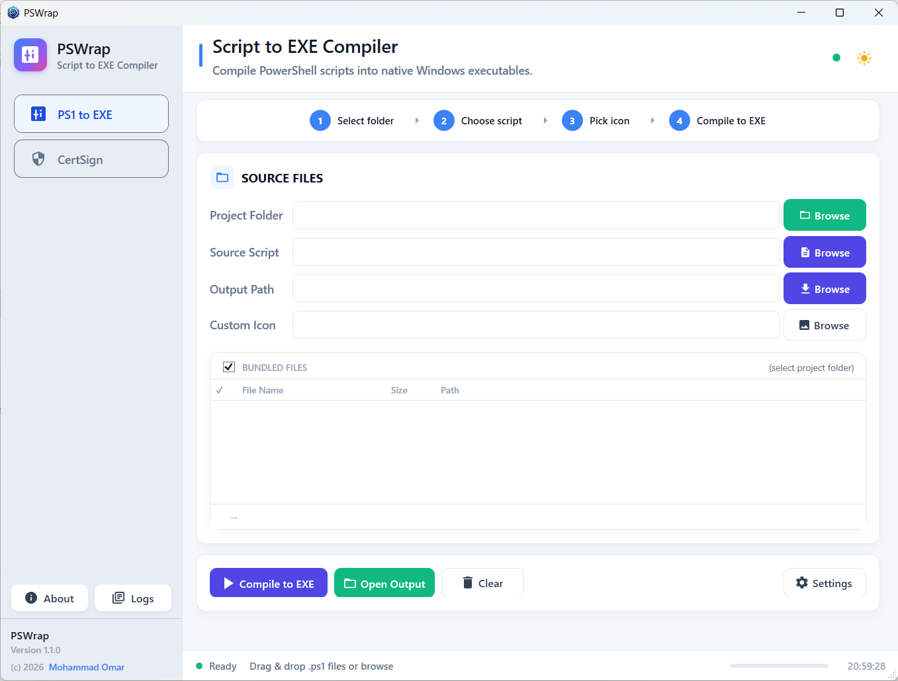

<div align="center">

# 📦 PSWrap

**PowerShell Script to EXE Compiler**

A modern WPF tool that wraps `.ps1` scripts into native Windows executables — with Authenticode signing, icon embedding, and companion bundling built in.


</div>

---

# 📖 Overview

**PSWrap** is a desktop application that compiles PowerShell scripts into standalone Windows executables using in-process C# CodeDOM compilation — no external packers, no Base64 blobs, no temp files. Your script is embedded as a managed resource and re-launched by native .NET hosting when the EXE runs.

It goes beyond compilation: generate your own code-signing certificate chain, sign the output with Authenticode (optional RFC 3161 timestamping), bundle companion files as embedded resources, and embed a custom icon — all from one window.

> **Repo:** [github.com/mabdulkadr/PSWrap](https://github.com/mabdulkadr/PSWrap)

### 🖼️ Screenshots



*Main window (light theme): the four-step wizard, source files form, bundled files grid, and the CertSign page in the sidebar.*

---

# ✨ Core Features

### 🔹 Compilation Engine
* In-process **CodeDOM compilation** with automatic `csc.exe` fallback on PowerShell Core 7.x
* Script embedded as a **managed resource** — clean decompilation story, no temp extraction
* Async, non-blocking builds with progress feedback
* Full assembly metadata: version, description, product, copyright, company, trademark
* Options: GUI vs Console output, suppress output/error streams, UAC manifest, config file, platform target, apartment state

### 🔹 Certificate Signing
* Generates a self-signed **Root CA + Code Signing certificate chain** using pure .NET cryptography
* Signs executables with **Authenticode**, optional RFC 3161 timestamping
* Ships with ready-to-use sample certificates in `cert\`

### 🔹 Bundling & Icons
* Embed entire companion folders as resources, with selective inclusion checkboxes
* Custom `.ico` embedding — or automatic conversion from PNG/JPG/BMP/GIF
* Built-in default icon when none supplied

### 🔹 Smart Detection & UI
* Selecting a project folder auto-detects the `.ps1` source and `.ico` icon
* Dark/Light theme — Tailwind Slate tokens with instant switching
* Toast notifications, KPI stat cards (Last Compile, Source Size, OS Target, Output Type, PS Version)
* Drag & drop `.ps1` files straight onto the window
* Live log viewer inside the app
* Persistent settings — theme, paths, and build config saved to `%APPDATA%\PSWrap\settings.json`

---

# 📂 Project Structure

```text
PSWrap/
│
├── PSWrap.ps1                  # Entry point (console-hide P/Invoke + module loader)
├── PSWrap.exe                  # Pre-built release binary
│
├── config/
│   └── AppConstants.ps1        # Paths, version, metadata constants
│
├── src/                        # Core modules
│   ├── Environment.ps1         # Runtime checks (STA, .NET, assemblies)
│   ├── Logging.ps1             # Daily-rolling file logger
│   ├── WpfHelpers.ps1          # Brush/token/theme helpers
│   ├── Settings.ps1            # %APPDATA% settings load/save
│   ├── UiLoader.ps1            # XamlReader loader + theme engine
│   ├── EventHandlers.ps1       # All control event wiring
│   ├── Startup.ps1             # Restore settings, show window
│   └── Features/
│       ├── Compiler.ps1        # CodeDOM/csc.exe compile pipeline
│       ├── CertSign.ps1        # Root CA + code-signing generation
│       ├── LogViewer.ps1       # In-app log console
│       ├── SettingsDialog.ps1  # Build configuration dialog
│       └── AboutInfo.ps1       # About window
│
├── xaml/                       # WPF layouts (MainWindow + embedded variant)
├── cert/                       # Sample CA + signing certificates
├── docs/                       # USER-GUIDE.md, ABOUT.md
├── images/                     # Application icons
└── logs/                       # Daily logs: PSWrap_yyyyMMdd.log (auto-created)
```

---

# 🚀 Usage

### Launch

```powershell
powershell.exe -STA -File ".\PSWrap.ps1"
```

Or double-click `PSWrap.ps1`, or run the pre-built `PSWrap.exe`.

### Compile a script

1. **Select Project Folder** *(optional)* — auto-detects your `.ps1` and `.ico`
2. **Select Source Script** — browse or drag-and-drop
3. **Set Output Path** — where the `.exe` will be written
4. **Choose Icon** *(optional)* — `.ico`, or any image for auto-conversion
5. **Configure** *(optional)* — metadata, output type, platform, bundling
6. **Compile to EXE** — runs async; watch progress in the live log
7. **Sign** *(optional)* — generate a code-signing chain and sign with timestamp

---

# ⚙️ Requirements

| Requirement | Details |
|-------------|---------|
| **Operating System** | Windows 10 / Windows 11 |
| **PowerShell** | Windows PowerShell 5.1, or PowerShell 7.x (`csc.exe` fallback) |
| **.NET Framework** | 4.7.2+ (included with Windows 10/11) |
| **Admin rights** | Only for the TrustRoot option (installs the CA into Trusted Root) |

### Logs & Settings

```text
Logs:     <app root>\logs\PSWrap_yyyyMMdd.log   (daily rolling, auto-created)
Settings: %APPDATA%\PSWrap\settings.json
```

---

# 🛡 Operational Notes

* **Signing trust model** — generated certificates are self-signed; distribute `PsWrapCert.ca.crt` to machines that must trust your signed EXEs, or use the TrustRoot option (admin) during generation
* **Antivirus false positives** — unsigned/uncommon EXEs may be flagged; Authenticode signing significantly reduces this
* **Source of truth** — always keep the original `.ps1`; treat compiled EXEs as build artifacts
* **Execution policy** — the compiled EXE hosts PowerShell itself, so target machines do not need script execution policy changes
* Compiled output inherits your script's behavior — test in staging before distributing

---

## 👤 Author

**Mohammad Abdulkader Omar**  
GitHub: [@mabdulkadr](https://github.com/mabdulkadr)  
Website: [momar.tech](https://momar.tech)  

---

## 📜 License

This project is licensed under the [MIT License](LICENSE).

---

## ⚠ Disclaimer

This skill and every script it generates are provided as-is with no warranty
of any kind. Test generated tools in a staging environment before deploying to
production. The authors assume no liability for any damage or data loss
resulting from their use.

---

<div align="center">

⭐ **If this tool saves you time, star the repo — it helps others find it.**

[Report an Issue](../../issues) · [momar.tech](https://momar.tech)

[](https://www.buymeacoffee.com/mabdulkadrx)

Built with [**PowerShell Enterprise Admin**](https://github.com/mabdulkadr/powershell-enterprise-admin-skill)

</div>
